# fm1-chord

A custom firmware that turns the M-VAVE FM-1 pocket synth into a chord-machine style instrument.
Built on [Felucca](https://github.com/hugelton/Felucca). Clean-room: nothing from any other instrument's firmware.

**White keys play chords, then strum them.** The seven white keys at the left are the scale degrees
in the current key and scale, so every chord fits: the first is I, the next ii, up to vii. The nine
white keys to their right are a strumplate, as on an Omnichord: each plays one note of the chord
last played, rising from key to key, so a swipe across them strums it. In LEAD every white key is
a note of the scale instead, up from the tonic, as many at once as you hold. The screen names the chord (or the note) and shows
it on a piano; at rest it shows what every key does.

**Black keys change them.** The eight black keys of the middle octaves are the chord machine's joystick
directions (7ths, 9ths, sus, dim, aug, borrowed chords, in four tables); F#3 cycles the inversion
(C, C/E, C/G), G#3 locks a change to a key, A#3 holds. With BASS on SLASH (the default), the key held
first is the bass and the next one the chord: Em/C.

**Everything else a chord machine does:** Play, Strum, Lead, Drone, Arp, Repeat, a 16-step chord
sequencer, drum pads, 56 drum loops, a 4-layer looper, a mixer, Chord Hiro and the Ear Trainer; 37 sounds
(36 classic ones, plus an acoustic guitar for leads),
7 envelope presets, reverb, delay, chorus, flanger, tremolo, vibrato, glide, drive, tape, stereo, a filter
wheel; key, scale, bass, voices, voice leading; four presets; MIDI in and out. Only the mic features and
Bluetooth are missing.

**Controls.** Four layers, as in SLOOP and JIANT: **ALGORITHM** picks layer 1 to 4, each with its own
sound and play style, and the looper records into the selected one. **PRESETS** picks the sound, on every screen.
The menu buttons are colour-coded. **EDIT** tapped steps to the next play style, **ARP** to the one before. On HOME, KNOB 1 to 4 are that
style's own settings, named along the foot of the screen: filter, resonance, attack and release while it plays the
sound (STRUM: its speed for the attack), ARP its pattern, rate and layer, LOOPS its loop, variation, kit and the
tempo, DRUM and SEQ their kit or length and the tempo, HIRO the song, difficulty and speed. The other buttons, tapped,
open a menu of a few pages of four cards, after JIANT: KNOB 1 to 4 set the four cards, SELECT walks the pages, and the
same button tapped again goes on to the next page, round. **SCL** KEY (KEY: key, scale, octave, layout; CHORD: bass,
voices, voice leading, joystick), **FX** SOUND (FILTER, AMP, SPACE, MOTION, WOBBLE, COLOUR: the filter, the envelope
and every effect with its amount), **GLO** MIX (the levels, TEMPO, SETUP: speaker, output, MIDI in, theme), **SEQ**
LOOPER (bars, clear all), **SAVE** PRESETS (SAVE again: the next slot, OCT+ saves; KNOB 2 then OCT+ loads). ENV and LFO
open SOUND's AMP and WOBBLE pages. An action card (CLEAR, LOAD, SAVE) is armed by turning it and done with OCT+;
otherwise OCT− / OCT+ are the octave. Held, a menu button is a layer: the white keys
and KNOB 1 to 4 change job while it is down, their map on the screen. **SCL** key (any key sets the key; knobs scale,
bass, voices, joystick), **FX** sound (a key a sound, 16 a page; knobs page, envelope, reverb, delay), **EDIT** mode
(keys 1 to 11 the play style: PLAY, STRUM, LEAD, DRONE, ARP, REPEAT, SEQ, DRUM, LOOPS, HIRO, EAR; knobs strum, arp,
rate, kit), **GLO** mix (keys 1 to 4 mute the layers, 7 the metronome, 16 tap tempo; knobs the levels), **SAVE**
presets (keys 1 to 4 load P1 to P4, 5 to 8 save them, each with its loop). REC on a layer that already plays arms the
next empty one; REC held clears the layer, held on to 2 s everything. Your settings and the loop come back after
power-off (the loop paused: PLAY). The presets' loops live in Felucca's third user sample slot, as JIANT keeps its
songs there: two user sample slots remain (USR1, USR2).

| | | |
|---|---|---|
| 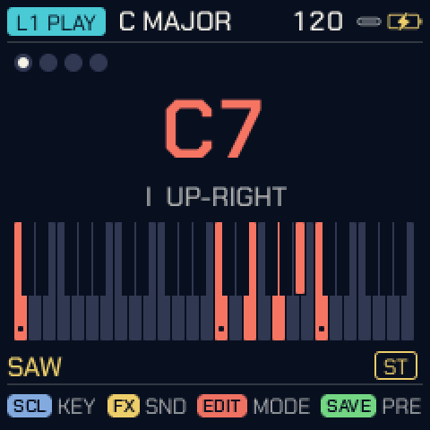 | 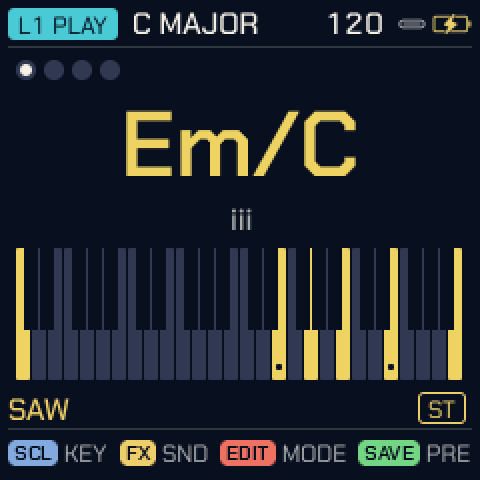 | 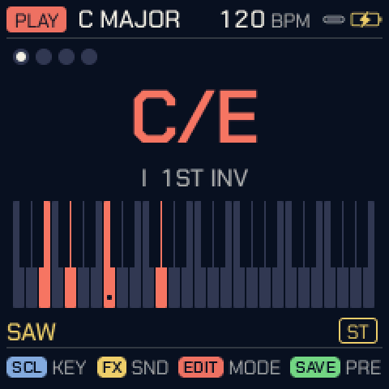 |
| 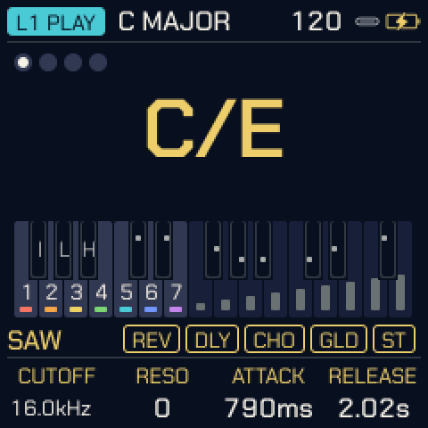 | 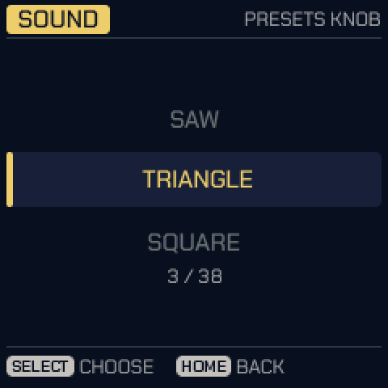 | 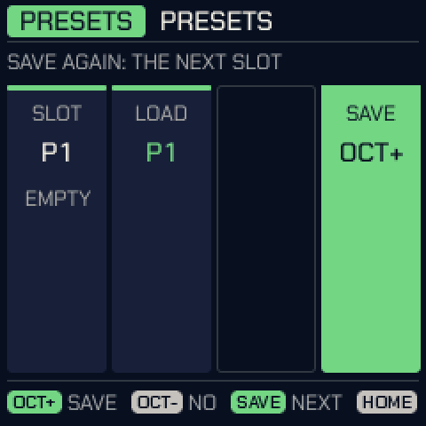 |
| 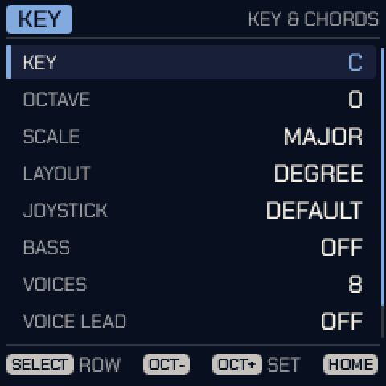 | 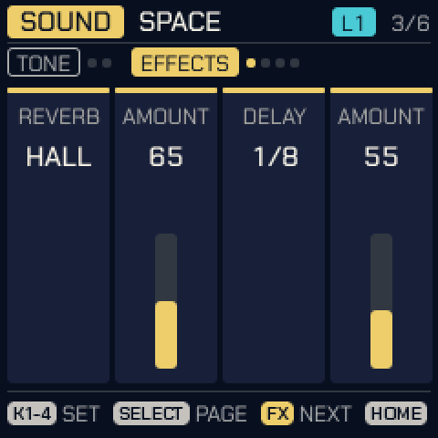 | 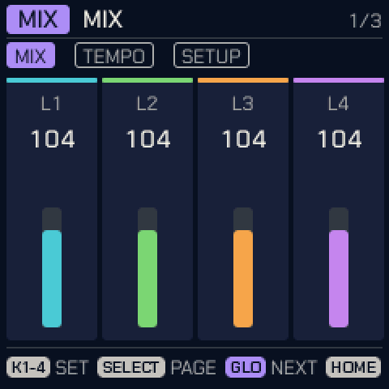 |
| 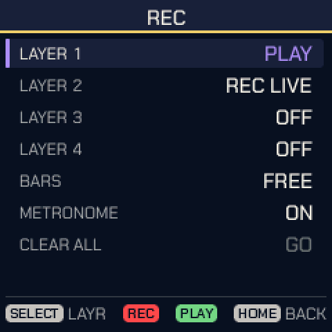 | 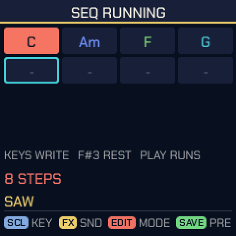 | 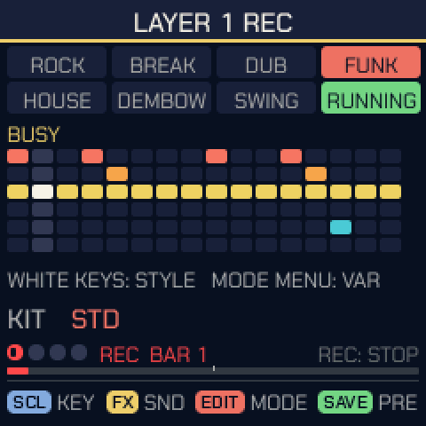 |
| 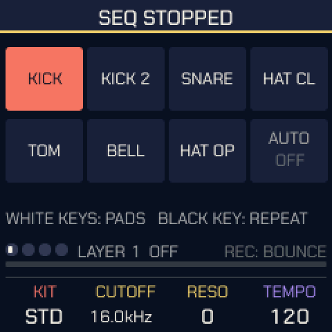 | 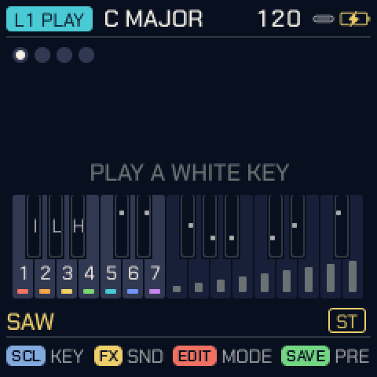 | 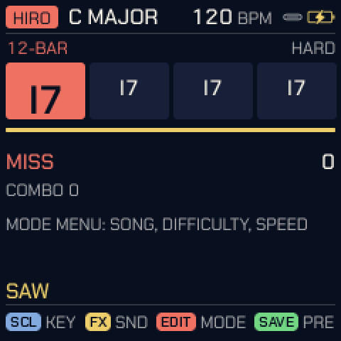 |
| 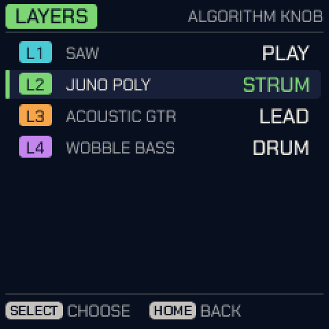 | 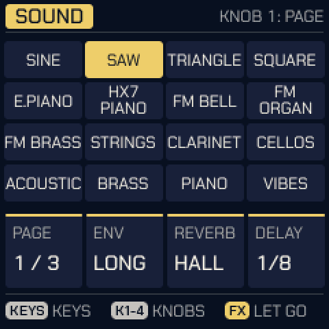 | 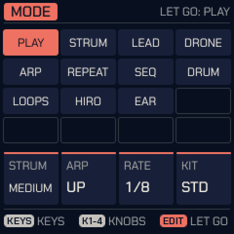 |

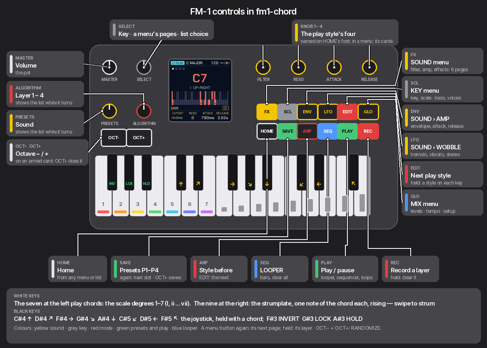

**Themes.** The screen takes every colour from a palette: SOUND > THEME switches between them (LAPIS, the
default, plus Felucca's eight). A palette is one row in `tools/gen_ui_palettes.py`: background, surface, text,
theme and accent, from which the tints are derived, plus the chord UI's role colours (KEY, SOUND, MODE, PRESET,
LOOP, OK) and the seven degree colours in `CHORD`. A palette without its own role colours gets the classic ones.
The tool checks the contrast of every pairing and fails the build on a miss. The type is Chakra Petch (SIL OFL),
as in [Tessera](https://github.com/Rastapopolix/tessera), whose palette LAPIS follows.

Status: running on an FM-1 (installed over USB-MIDI with `tools/fm1_install.py`, 28 % CPU at idle)
and tested on the host simulator. It also runs in the
[FM-1 emulator](https://github.com/simonjohansson/fm1-emulator) with a patch set on its released
build that adds the knobs and WAV recording: `tools/emulator/run.sh` fetches, patches, builds and
launches it. Factory reset: hold HOME + SAVE while powering on, or `factory yes` on the USB console.
Spec and notes in [spec/docs](spec/docs); build, flash and the findings on the unit in
[spec/docs/05-dev-setup.md](spec/docs/05-dev-setup.md) and [spec/docs/11-hardware-findings.md](spec/docs/11-hardware-findings.md).
GPL-3.0, as Felucca.
