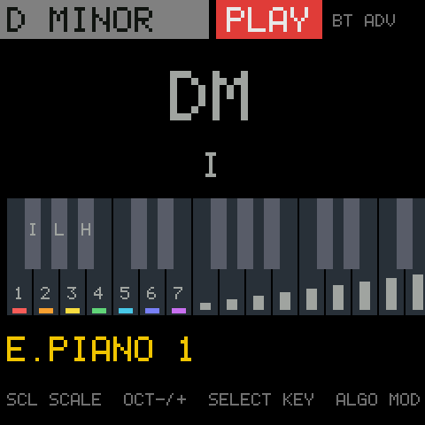

# The SDK port

fm1-chord on M-VAVE's official FM1 Open SDK ([m-vave/fm1_open](https://github.com/m-vave/fm1_open))
instead of Felucca's bare-metal hardware layer. The SDK's binary library holds the RTOS, USB, the
Bluetooth stack (BLE MIDI as peripheral or central, Bluetooth audio in) and the stock synth; the app
supplies the audio interrupt, the panel glue and the user interface. That is the only route to the
FM-1's radio.

## What is here

- `build.sh [OVERLAY]`: builds the official app the way `sdk/Build.ps1` does (the same clang flags,
  the same link line against `libfm1_engine.a`, the same layout) with JieLi's Linux toolchain
  (`tools/get_toolchain.sh`), checks the image (`tools/fm1_check.py`: every test the official script
  makes) and packages it (`tools/fm1_package.py`, a Python port of the MIT `Package.cs`). With an
  overlay directory, its files replace the official app's. Needs the `fm1_open` checkout at
  `~/fm1/fm1_open` (`FM1_OPEN`); `OUT_DIR` picks the output directory (default `build/port`).
- `app/`: the overlay. `screen.c` replaces the official UI with the chord keys (the seven degrees at
  the left, the strumplate, INVERT / HOLD, the eight directions, SLASH bass, PLAY and LEAD) and a HOME
  screen; what the keys build plays as MIDI into the instrument's first track, so every stock sound is
  a chord sound and BLE MIDI carries the notes out. `version.h` gives it the update identity
  FM-1_8000900. The harmony is `firmware/src/harmony.c`, shared with the Felucca build.
- `tests/port_test.c`: the overlay on the host against stubs of the SDK (`FM1_HOST_TEST`): scripted
  keys, the MIDI posted and the screen painted checked, the screen written as a PPM (`home.png`: the
  HOME screen after the test, in the stock app's 5 x 7 font for now).

## Verified (2026-10-16)

- The toolchain: our rebuild of the unmodified official app is byte-identical to M-VAVE's own
  `FM1_OFFICIAL_OPEN` package (the workbench's download) except the 32-byte build identity and the
  checksums that follow from it: 46 bytes of 475 700.
- The port app builds, links and passes every structural check: a 396 KB app image, 303 KB of heap.
- Not yet run on the FM-1. The official package carries a different bootloader from the stock V15
  one (18 % of the bytes in common), and M-VAVE's loader rewrites the flash head; from a Felucca
  firmware the installer refuses it without `--force`. The route back from the Open firmware's
  updater to a Felucca package is untested. Both are decisions for a session with the recovery dongle
  at hand (`tools/fm1_install.py fm1-chord-port.fwsc --force`; the data flash was backed up to
  `flash_backup_2026-10-16.bin` first, and the Felucca build's console has `flr` / `fle` / `flw` to
  read, erase and program it back).

## Licensing

The SDK's binary may be linked, built and redistributed in firmware for FM-1 devices (its
`THIRD_PARTY.md`). M-VAVE's app sources are GPL-3.0 with a linking exception. Felucca's engines,
effects, canvas and fonts are GPL-3.0 without one and are not used here; only code whose copyright is
ours, or M-VAVE's, goes into this port.
